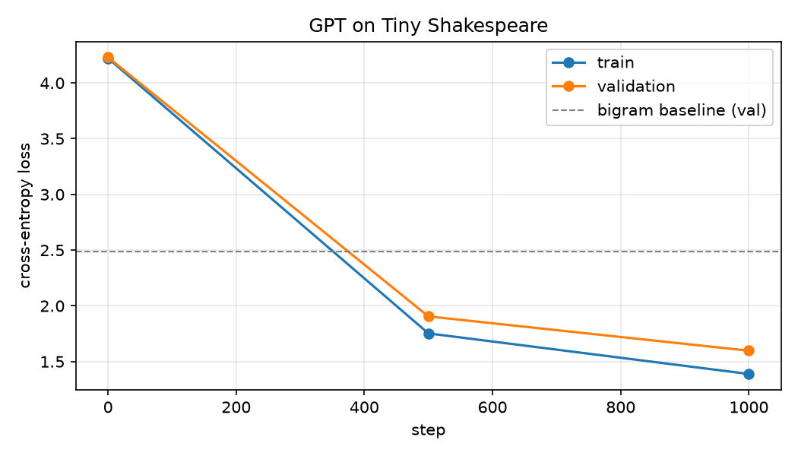

# GPT William Shakespeare

A **decoder-only Transformer (GPT)** built from scratch in PyTorch and trained at the character level on the complete works of Shakespeare. It generates new, Shakespeare-style dialogue one character at a time.

> Built while working through Andrej Karpathy's *"Let's build GPT: from scratch, in code, spelled out."* The implementation, training run, experiments and write-up are my own.



## Highlights

- **Every component built from first principles:** tokenizer, batching, scaled dot-product attention, multi-head attention, feed-forward layers, residual connections and LayerNorm. No `nn.Transformer` and no pretrained weights.
- **10.79M-parameter model** trained on a laptop GPU (RTX 4050, 6 GB) in **about 7 minutes** using bf16 mixed precision.
- **Validation loss 1.60**, compared with **2.49** for a bigram baseline. In practice that means going from random letter soup to readable play-script dialogue.
- **Learning notebook** that builds the model step by step, from a lookup table to self-attention, with explanations and outputs.
- **Clean CLI** for training, early stopping, checkpointing and sampling.

## Sample output

Generated by the trained model from a single newline, with no prompt:

```text
And they bridler and is not the dispokeral deed,
That I charge and barn thy purquest.

PAULIXENES:
I away, my father, why lord
You shall find you have now
What said entent, will is there by Saint Warwick
With justicler no me little my dear: what I am speak
you love's nor ope to the quickly, demoth keep Willow her evils,
'Tis too rival in him he poor own for unto and thrumself;
Are give me to thy fledgeth, and revery home.
```

Prompted with `ROMEO:`:

```text
ROMEO:
Ay, Joy.

VERDITA:
Tyball this as herd?

ROMEO:
She &C:
He fair the woe; but be any sail now,
What is new, as be reason old you keep were sumble antrance,
A time father last news? within, rememble, heart?
```

From raw characters alone, the model has learned spelling, speaker tags, line breaks, verse rhythm and archaic diction. Its "characters", such as *PAULIXENES* (Paulina + Polixenes) and *VERDITA* (Perdita), are blends of real ones from *The Winter's Tale*. More output is in [`samples/`](samples/), including a [10,000-character sample](samples/sample_10k.txt).

## Results

| Model | Parameters | Context | Val loss |
|---|---|---|---|
| Uniform guess | – | – | 4.17 |
| Bigram (lookup table) | 4K | 1 char | 2.49 |
| **GPT (this repo)** | **10.79M** | **256 chars** | **1.60** |

| Step | Train loss | Val loss | Time |
|---|---|---|---|
| 0 | 4.222 | 4.231 | 0 min |
| 500 | 1.753 | 1.905 | 4 min |
| 1000 | 1.389 | **1.598** | 7 min |

Training stopped early once validation loss passed the 1.7 target (`--target_loss 1.7`). The full log is in [`train_log.json`](train_log.json).

## Architecture

```
input characters  (B, T)
      │
      ├─ token embedding (65 → 384)  +  position embedding (256 → 384)
      ▼
┌───────────────────────────────────────────┐
│  Transformer Block  × 6                    │
│    x = x + MultiHeadAttention(LN(x))       │   6 heads × 64 dims, causal mask
│    x = x + FeedForward(LN(x))              │   384 → 1536 → 384, ReLU
└───────────────────────────────────────────┘
      │
      ├─ LayerNorm → Linear (384 → 65)
      ▼
next-character logits  (B, T, 65)
```

| Hyperparameter | Value |
|---|---|
| Embedding dim (`n_embd`) | 384 |
| Layers / heads | 6 / 6 |
| Context length (`block_size`) | 256 |
| Batch size | 64 |
| Dropout | 0.2 |
| Optimizer | AdamW, lr 3e-4 |
| Precision | bf16 autocast (TF32 matmuls) |

## Repository

| File | Description |
|---|---|
| [`gpt.py`](gpt.py) | Full model, training loop and sampling CLI in a single file |
| [`gpt_from_scratch.ipynb`](gpt_from_scratch.ipynb) | Step-by-step learning notebook, with outputs |
| [`train_log.json`](train_log.json) | Loss history, hyperparameters and hardware details |
| [`samples/`](samples/) | Generated text |
| [`input.txt`](input.txt) | Tiny Shakespeare dataset (~1.1M characters) |

## Quickstart

```bash
pip install -r requirements.txt

python gpt.py train                          # full 5000-step run (saves best checkpoint to gpt.pt)
python gpt.py train --target_loss 1.7        # stop early once val loss <= 1.7
python gpt.py sample --tokens 1000           # generate from the trained model
python gpt.py sample --prompt "ROMEO:" --seed 7
```

The trained checkpoint (`gpt.pt`, ~50 MB) is not committed to the repo. One training run recreates it.

## What I learned

1. **Language modeling as next-token prediction.** A single chunk of text holds `block_size` training examples, one for every context length. That is why the model can generate from a single character.
2. **Self-attention is weighted averaging.** It starts from the simple "average of the past" trick, a lower-triangular matrix times the input, and then makes the weights depend on the data through queries and keys.
3. **Why attention is scaled.** Dividing by `sqrt(head_size)` keeps score variance near 1. Without it, softmax saturates toward one-hot and each token listens to a single neighbor (shown in the notebook: variance 17.5 drops to 1.1).
4. **Masking is what makes it a decoder.** The causal mask stops tokens from seeing the future. An encoder (as in BERT) simply removes it.
5. **What makes deep networks trainable.** Residual connections give gradients a direct path through the network, pre-LayerNorm keeps activations well scaled, and dropout regularizes a model with 10M parameters trained on only 1M characters.
6. **Practical GPU training.** Mixed precision, evaluating on a held-out split, and keeping the best checkpoint rather than the last one.

## Next steps

- Sub-word (BPE) tokenization, as GPT-2 uses
- Fused attention (`F.scaled_dot_product_attention`) and `torch.compile` for faster training
- Learning-rate warmup with cosine decay, plus gradient clipping
- Temperature and top-k sampling controls

## Acknowledgements

- Andrej Karpathy: *Let's build GPT: from scratch, in code, spelled out.*
- Vaswani et al., 2017: [*Attention Is All You Need*](https://arxiv.org/abs/1706.03762)
- Dataset: [Tiny Shakespeare](https://github.com/karpathy/char-rnn/tree/master/data/tinyshakespeare)

---

**Author:** [Blink-emines](https://github.com/Blink-emines)
